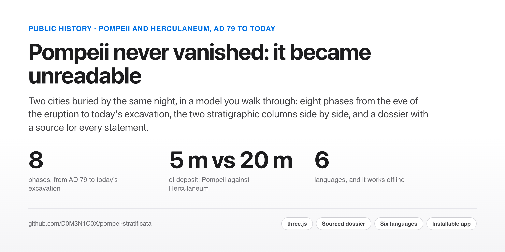

<picture>
  <source media="(prefers-color-scheme: dark)" srcset="site-assets/cover-dark.png">
  
</picture>

<p align="center">
  <a href="https://d0m3n1c0x.github.io/pompei-stratificata/?lang=en"><b>Open the model</b></a> ·
  <a href="https://d0m3n1c0x.github.io/pompei-stratificata/dossier/en/">Read the dossier</a> ·
  <a href="README.it.md">Italiano</a>
</p>

# After AD 79: Pompeii and Herculaneum

Two cities buried by the same night, in a model you walk through. **Pompeii** across eight phases, from the eve of
the eruption of AD 79 to today's excavation; **Herculaneum** limited to what has actually been excavated, with the
excavation front and the modern city above the rest; and a **section that sets the two stratigraphic columns side by
side at the same scale**: five metres against twenty. The data of a documentary dossier are anchored to the places
where they were collected.

> The repository keeps the address `pompei-stratificata`: renaming it would break the GitHub Pages address, which is
> not redirected after a rename.

## The question

"Why was Pompeii not excavated before the sixteenth century?" is the wrong question, and the project starts from
refusing to answer it as asked. People dug, and how: in the days after the eruption and for centuries, owners
recovering what they could, systematic stripping of materials, looting. What did not exist was **digging to know**.
Nor was the site forgotten: what was lost was the link between the place, still called *Civita*, and the name,
recovered only in 1763 with the inscription *rei publicae Pompeianorum*, 1,684 years after the eruption and fifteen
years into the Bourbon excavations.

The model makes visible an argument that stays abstract in words: under about five metres of deposit, a four-metre
ground floor disappears and the upper floor does not. **Pompeii was never invisible: it became unreadable**, which is
why it stayed within reach of salvagers, looters and, four centuries later, of the people who came back to live there.
Herculaneum shows that the conclusion depends on the deposit, not on people: the same night, fifteen kilometres away,
no Plinian fallout and about twenty metres of pyroclastic currents. Nobody came back, and a new town was built on top
without knowing what lay beneath. **Pompeii became unreadable, Herculaneum unreachable.**

## What is inside

| | |
|---|---|
| **Eight phases** | AD 79 (the eve and the burial) · 1st–3rd c. · 4th–5th c. · 15th–16th c. · 1592–1600 · 1748–1763 · today |
| **Populations** | people, dogs and pigeons animated by phase, fleeing during the eruption; scenic densities, not censuses |
| **Twenty places** | each with its data card and the source at the bottom of the panel |
| **Section mode** | cuts the ground and shows the stratigraphy from inside, with heights on the cut face |
| **Real sun** | the sun's position computed for Pompeii (40.75° N) on Europe/Rome time |
| **Sound** | a soundscape for each phase and the timbre of instruments found as finds around Vesuvius (tibiae, cornua, cymbala), all synthesised in code |
| **Comparison** | the Pompeii and Herculaneum sections side by side at the same scale, with the modern city above Herculaneum |
| **Herculaneum** | the excavation on foot: two decumani, three cardines, the insulae, the terraces, the twelve boat sheds on the ancient beach |
| **Guided tour** | fourteen stops in narrative order, changing phase on its own |

It runs on a computer, on a phone (on-screen controller) and with a Bluetooth gamepad, in six languages (Italian,
English, French, German, Spanish, Portuguese), and installs as an app that **works offline** after the first visit.

## What it is not

The project only stands if it is honest about its limits; the full list is in [README.it.md](README.it.md#che-cosa-non-è).

- **Not an archaeological survey.** The plan follows the real urban layout (nine *regiones*, streets, seven gates,
  the monuments' positions), but volumes are schematic and the grid is straightened.
- **Measured proportions only where published**: the Great Palaestra at Pompeii; the Palaestra, the Basilica Noniana
  and the House of the Stags at Herculaneum. Everything else is deduced from plans.
- **Declared inventions are labelled as such**, like the course of the Conte di Sarno canal, for which no scientific
  source was found.
- **The sound is not a reconstruction**: it plays the timbre of instruments that survive, never an ancient melody.
- **Where sources disagree, the model says so**: the depth of Herculaneum's deposit (16 to 25 m in the sources, drawn
  at 20 m), the true orientation of its grid.

## Method

Every statement in the dossier carries its source beside it, and where a source was not checked, it says so. A
**Gaps** section lists what was not verified, and a **verification log** records two corrections made after checking
the sources: the graffito in the House of N. Popidius Priscus was in Greek (*domus pertusa* is Fiorelli's Latin
rendering), and the idea that later eruptions added deposit over Pompeii was withdrawn, because no scientific source
documents it for the city. That second check revealed a gap the project declares as open research: **no
geoarchaeological study of the stratigraphic column above the AD 79 level inside Pompeii's walls appears to be
published.**

## Run it

No dependencies and no build step; three.js is included in the file.

```bash
python3 -m http.server 8000      # then open http://localhost:8000
npm run check                    # the project's own checks
```

## Licence

Code under MIT ([LICENSE](LICENSE)); texts, dossier and documentary content under CC BY 4.0
([LICENSE-CONTENUTI.md](LICENSE-CONTENUTI.md)); three.js, MakeHuman figures and CMU motion capture under their own
terms ([THIRD-PARTY-NOTICES.md](THIRD-PARTY-NOTICES.md)). To cite: [CITATION.cff](CITATION.cff).

## About

Built by **Domenico Perroni**: HR advisory and people analytics, with a master's in media education, based in Kraków.
[GitHub](https://github.com/D0M3N1C0X) · [LinkedIn](https://www.linkedin.com/in/domenico-perroni) · [Portfolio](https://d0m3n1c0x.github.io/)
